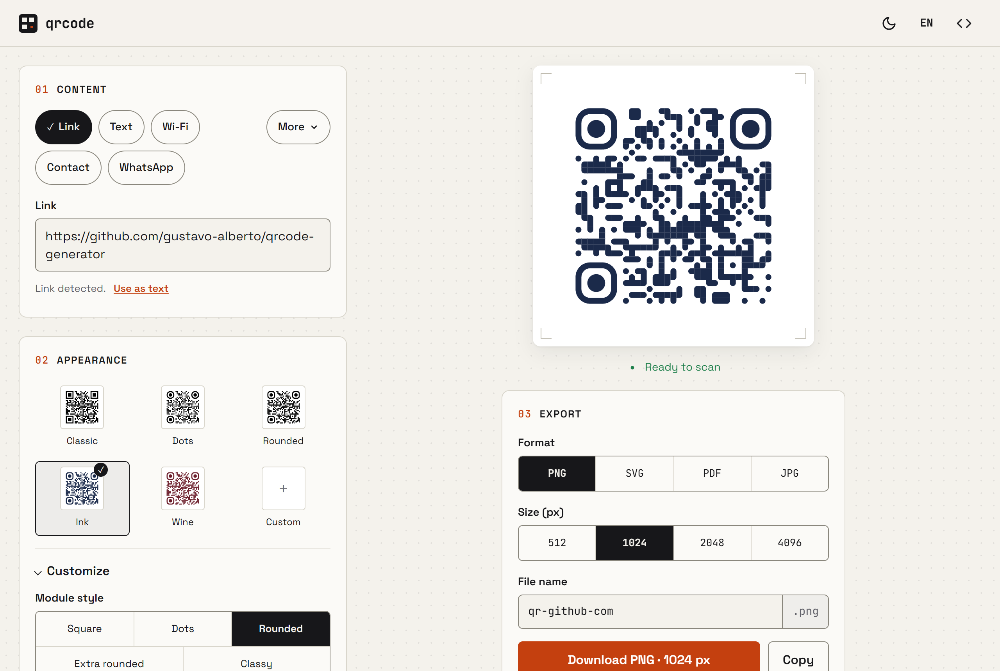
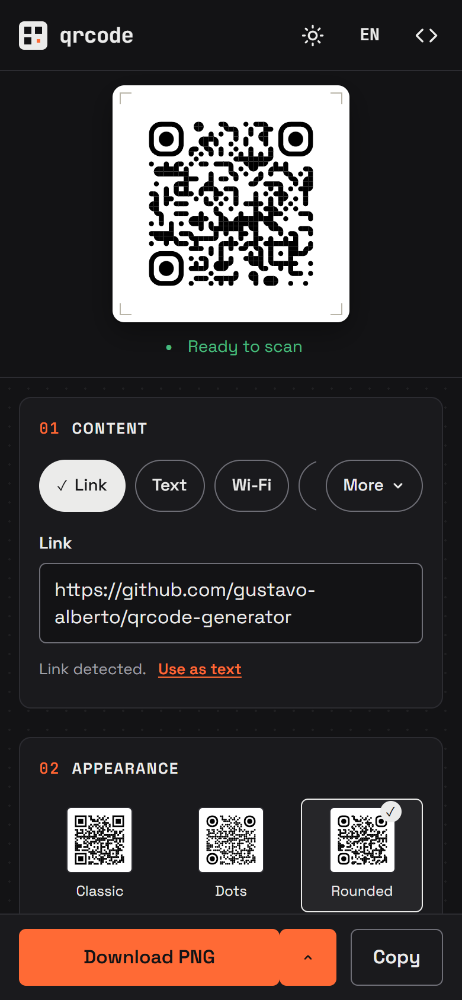

# qrcode-generator

A simple, self-contained web app to create static QR codes for links, text,
Wi-Fi, contacts and more, with visual customization and export to PNG, JPG,
SVG and PDF.

- **No backend, no account, no tracking.** Everything runs in your browser.
- **No external requests at runtime.** Libraries and fonts are bundled in the repo; it works offline.
- **No build step.** Plain HTML, CSS and JavaScript. Open `index.html` and it works.





## Features

**Content**

| Type | Encodes as |
|---|---|
| Link | URL (adds `https://` when missing) |
| Text | Plain text |
| Wi-Fi | `WIFI:T:WPA;S:…;P:…;;` (special characters escaped) |
| Contact | vCard 3.0 |
| WhatsApp | `https://wa.me/<number>?text=…` |
| Email | `mailto:` with subject and body |
| Phone | `tel:` |
| SMS | `SMSTO:` |
| Location | `geo:lat,lng` |
| Event | iCalendar `VEVENT` |

The link field detects what you paste: links, emails (`mailto:`) and phone
numbers (`tel:`); anything else becomes plain text. You can override the choice.

**Appearance**

- Presets with live thumbnails of your content, plus custom module style, corner style and colors.
- Transparent background (PNG, SVG and PDF).
- Error correction (Low 7% to Max 30%) and quiet-zone margin in modules.
- Centered logo (PNG, JPG or SVG up to 2 MB). Error correction is raised to Max automatically.
- Scan checks: warns about low contrast and inverted colors, with one-click fixes.

**Export**

- PNG and JPG at 512, 1024, 2048 or 4096 px. JPG always gets a solid background.
- SVG (vector, logo embedded).
- PDF: QR-only page or centered on A4, at 3, 5, 8 or 10 cm (300 dpi).
- Copy the image to the clipboard.
- File names derived from the content (never from passwords), editable.

**Everything else**

- Light and dark themes, English and Portuguese.
- Keyboard shortcuts: `Ctrl/⌘+S` download, `Ctrl/⌘+Shift+C` copy, `Ctrl/⌘+V` outside a field pastes into the link field.
- Accessible: keyboard navigation, screen reader labels and live status, visible focus, reduced motion.
- Only preferences (theme, language, appearance, export options) are saved in `localStorage`.
  Content and logos are never stored.

## Running

Open `index.html` directly in a browser (`file://` works), or serve the folder
with any static server:

```bash
npx serve .
```

```bash
python -m http.server 8000
```

Copying images to the clipboard requires a secure context (`https://` or
`localhost`). Some browsers disable it on `file://`; the Copy button explains
when it's unavailable.

## Testing

Unit tests cover the pure logic (payloads, detection, contrast, presets, render
options, export helpers, translations). They use Node's built-in test runner,
with no dependencies:

```bash
node --test
```

Requires Node.js 18 or newer. A manual checklist for the UI is in
[docs/TESTING.md](docs/TESTING.md).

## Deploying to GitHub Pages

The app is static, so GitHub Pages can serve the repository as-is:

1. Push the `main` branch to GitHub.
2. In the repository, open **Settings → Pages**.
3. Under **Build and deployment**, set **Source** to **Deploy from a branch**.
4. Select branch `main` and folder `/ (root)`, then **Save**.
5. After a minute, the app is live at `https://<user>.github.io/<repo>/`.

Any other static host works the same way: upload the folder.

## Project structure

```
index.html
css/
  tokens.css        design tokens, light/dark themes, @font-face
  styles.css        layout, components, states
js/                 classic scripts (no modules), so file:// works
  main.js           bootstrap: wires blocks, status, shortcuts, mobile preview
  state.js          preferences in localStorage (never content)
  i18n.js           English and Portuguese strings
  content.js        block 01: type picker, link/text field, forms
  payloads.js       payload builders and validation per type
  detect.js         link / email / phone / text detection
  appearance.js     block 02: presets, customize, logo, advanced, reset
  presets.js        appearance options, presets, sanitizing
  render.js         qr-code-styling wrapper and live preview
  validate.js       contrast and inverted-color checks
  export.js         PNG/JPG/SVG/PDF generation, clipboard, export panel
  ui.js             small DOM helpers (debounce, radio group, toast)
vendor/             pinned third-party libraries (see vendor/README.md)
fonts/              self-hosted fonts and their licenses
tests/              node:test suites for pure functions
docs/               manual test checklist and screenshots
```

Each script registers itself on `window.QRApp` in the browser and exports via
`module.exports` in Node, so the same files run in both.

## Third-party licenses

| Dependency | License |
|---|---|
| [qr-code-styling](https://github.com/kozakdenys/qr-code-styling) 1.9.2 | MIT |
| [jsPDF](https://github.com/parallax/jsPDF) 4.2.1 | MIT |
| [Space Grotesk](https://github.com/floriankarsten/space-grotesk) | SIL OFL 1.1 |
| [JetBrains Mono](https://github.com/JetBrains/JetBrainsMono) | SIL OFL 1.1 |

License texts are in [vendor/licenses](vendor/licenses) and [fonts](fonts).
Versions and sources are in [vendor/README.md](vendor/README.md).

## License

[MIT](LICENSE)
